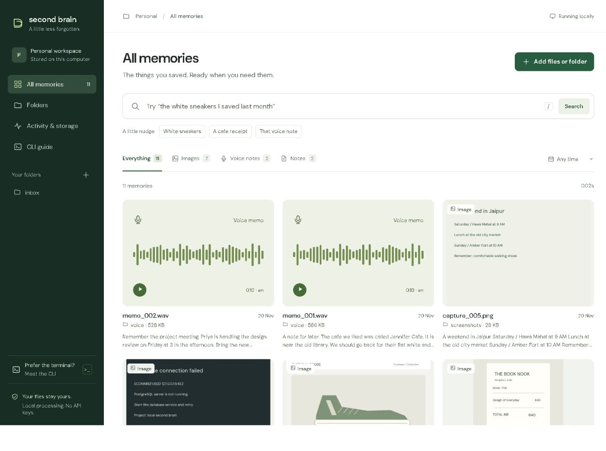

# Adaptive Second Brain

A local collection for screenshots, receipts, text notes, and voice memos. Index a chosen file or folder from CMD; search the same collection through a CLI or a Python-served visual interface. No Node.js, API key, Docker, or database server is required.

**Status:** working local prototype. Efficiency features and their limits are documented below; no unmeasured speedup or accuracy claims are made.

[Full installation guide](docs/INSTALL.md) · [Research paper (PDF)](output/pdf/adaptive_secondbrain_paper.pdf) · [Paper source](research/paper.md)



## Quick start on Windows CMD

Install Python **3.11** (recommended), clone or download this repository, and open CMD in the project folder:

```bat
setup.cmd
brain.cmd init
brain.cmd index "C:\Users\you\Pictures\Screenshots"
brain.cmd search "white sneaker last month"
brain.cmd serve
```

The browser opens at **http://127.0.0.1:8765**. Use **Add files or folder** to browse folders or paste any supported file/folder path. Indexing runs in the background with progress and per-file errors. Open a result to inspect its original, OCR text, transcript, and matching audio timestamp.

To run manually, or on macOS/Linux:

```sh
python -m venv .venv
# Windows CMD: .venv\Scripts\activate
# macOS/Linux: source .venv/bin/activate
python -m pip install -e ".[audio]"
brain init
brain index "path/to/your/files"
brain serve
```

Python 3.10–3.13 is supported. Base installation `pip install -e .` skips optional audio transcription. Use `python -m secondbrain` anywhere the package is installed, or the `brain` entry point in an activated environment. `brain.cmd` also works directly from this checkout.

First use downloads pretrained text, CLIP, and speech model weights; subsequent processing runs locally from cache. Download everything in advance with `brain models --audio`. It may take several minutes and several hundred MB. No personal media is uploaded to a model API. Initial OCR inference may initialize or download its own model assets through RapidOCR. Speech models remain optional; missing support produces an actionable per-file error.

## Try the included playground

```bat
brain.cmd --home .secondbrain init
brain.cmd --home .secondbrain index playground\inbox
brain.cmd --home .secondbrain search "white sneakers last month"
brain.cmd --home .secondbrain search "2499" --kind image
brain.cmd --home .secondbrain search "cafe near the old library" --kind audio
brain.cmd --home .secondbrain benchmark playground\scenarios.json --output playground-results.json
brain.cmd --home .secondbrain serve
```

`playground/inbox/` contains **synthetic** product screenshots, a changed-price pair, an exact duplicate, receipts, developer/travel screenshots, text notes, and synthesized voice notes. `playground/scenarios.json` contains expected results **outside** the inbox; these labels are never fed to the embedding or retrieval pipeline. This is a smoke benchmark, not an accuracy study.

File times are generated relative to the creation date. Regenerate fixtures with `python scripts/generate_playground.py` if relative-date examples get stale. The generator uses local Windows speech synthesis or `espeak`; the generated WAV files are included for other platforms.

## Commands

| Command | Purpose |
| --- | --- |
| `brain init` | Create/configure the collection |
| `brain index "path"` / `brain add "path"` | Embed one file or a recursive folder |
| `brain index "path" --force` | Reprocess files with current settings |
| `brain sources add "folder"` | Register a folder without indexing yet |
| `brain sources list` | List registered folders |
| `brain sources remove "folder"` | Stop tracking a folder, retain its indexed memories |
| `brain sync` | Index changes in registered folders |
| `brain watch` | Watch registered folders until Ctrl+C |
| `brain watch "folder"` | Index and watch a chosen folder |
| `brain search "query"` | Hybrid visual + semantic + keyword retrieval |
| `brain search "query" --kind audio` | Filter modality: image/audio/text |
| `brain search "query" --folder "folder"` | Restrict to one source folder |
| `brain search "query" --after 2026-10-01 --before 2026-10-31` | Explicit inclusive calendar date bounds |
| `brain search "query" --lexical-only` | Search extracted words without loading embedding models |
| `brain search "query" --refine --budget 5` | Selectively retry uncertain matching image OCR |
| `brain search "query" --json` | Machine-readable results, paths, timestamps, channels |
| `brain ask "question"` | Show quoted source evidence |
| `brain ask "What is the receipt total for Juniper Cafe?" --refine` | Retry OCR and show the cited total or explain why evidence is insufficient |
| `brain ask "question" --model "your-local-model"` | Answer using an already installed local Ollama model |
| `brain serve --port 8765` | Local visual interface |
| `brain status` | Actual file, vector, storage, and activity statistics |
| `brain doctor` | Environment checks without downloading models |
| `brain models --audio` | Prefetch selected models |
| `brain forget "path"` | Forget indexed files while preserving originals |
| `brain prune` | Forget missing original locations |
| `brain repair --dry-run` / `brain repair` | Count or refresh image and audio evidence from earlier versions |
| `brain benchmark playground/scenarios.json` | Execute labeled retrieval scenarios |

The optional global `--home` argument goes **before** the command. Default storage is `%LOCALAPPDATA%\SecondBrain` on Windows and `~/.local/share/secondbrain` on Linux/macOS. Set `SECONDBRAIN_HOME` or use `brain --home .secondbrain ...` for a repository-local collection. CLI and UI must use the same home to share data. Data/model caches are gitignored when repository-local.

After upgrading to 0.2.0, use `brain repair --dry-run` to see how many images and recordings need refreshing. Run `brain repair` in the same collection, with the audio extra installed if you indexed recordings. Repair commits each file independently. Run it again after an interruption to continue. If an original changed or moved, index its current location to refresh the evidence. Regular indexing and sync also refresh affected files as they encounter them.

Ask can cite receipt totals, invoice identifiers, and displayed product prices from image text. Include the merchant or product name when the collection has multiple matching images. Open a citation to see the highlighted line. Use **Refine OCR** in the browser or `brain ask --refine` to retry recognition. If the retry produces a conflicting reading, both readings are available for inspection and the app declines to choose a value. Other Ask queries continue to show excerpts or use optional local Ollama.

## Architecture and efficiency

```text
CLI / localhost UI
        |
    shared Brain engine
        |
hash + route + reuse
   |           |           |
image       voice        text
CLIP        VAD + ASR    chunking
delta OCR   timestamps
   |           |           |
SQLite: metadata + FTS5 + INT8 vector blobs
        |
filtered exact vector search + keyword search
        |
reciprocal rank fusion -> original evidence
        |
optional selective OCR retry / local Ollama answer
```

- **Exact deduplication:** SHA-256 identifies bytes, while separate locations retain aliases. Same-size/same-mtime files are still hashed. Changed content is reprocessed; old versions with no remaining locations are removed atomically. Originals are never deleted.
- **Changed-region OCR:** a perceptual hash only proposes related images. Exact native-resolution pixel differences determine the OCR crop. Existing text boxes enlarge affected crops; unchanged OCR lines are reused, and overlapping stale lines are replaced. Uncertain/large changes fall back to full OCR. Each unique image retains its own visual embedding. JPEG recompression, scrolls, and layout shifts may make reuse ineffective.
- **Compact vectors:** symmetric per-vector INT8 storage stores one byte per component plus scale/norm metadata. No float32 corpus copies are retained. The UI reports actual vector payload and database size separately. The baseline uses BGE-small (384D) and paired CLIP models (512D); it does **not** truncate untrained vector dimensions or claim Matryoshka compression.
- **Independent spaces:** BGE text search and CLIP text-to-image search use their own query encoders. FTS5 handles exact extracted words. Asset-level reciprocal rank fusion prevents long recordings from receiving extra votes merely for having more chunks.
- **Selective refinement:** `brain search --refine` retries OCR for relevant, low-confidence images and preserves the initial extraction alongside any replacement. `brain ask --refine` can retry a requested field even when its image scored highly. Its alternate readings are returned with the answer. Both paths use a soft budget that includes retrieval and may be exceeded by an in-flight OCR call.
- **Speech:** multilingual Whisper `base`, CPU INT8, speech detection, and approximately 30-second chunks with original timestamps. Configure `brain init --audio-model small --language hi` when appropriate, then reindex. Synthetic English samples do not establish mixed-language accuracy.
- **Incremental sync:** registered folders, per-file atomic transactions, a stable-write debounce in the watcher, and cached processing signatures.

SQLite is deliberately the prototype's **single embedded database**: FTS5 plus packed vectors require no vector server. Dense search is an exact scan, not an ANN index, so latency grows linearly with collection size. Profile representative collections before migrating to LanceDB/Qdrant for larger scale. The implementation currently loads matching chunk metadata into memory during ranking; it is not designed for millions of chunks.

Relative dates use **file modification time**, not verified capture time, and the process's local timezone. Supported phrases: today, yesterday, this month, last month, last week (previous calendar week), and past week. File copies or edits can change dates. Near-duplicate lookup checks the latest 150 images. The CLI reports semantic-model failures as warnings and can still return lexical matches; it never silently replaces real embeddings with random vectors.

**Known quality limits from real-model testing:** all 10 answerable synthetic scenarios retrieved an expected file in the top five, but the unrelated/no-answer scenario still returned weak candidates. The current similarity cutoffs are heuristic, not calibrated answerability probabilities. Source retrieval does not prove that a question can be answered. Whisper base also transcribed the synthetic cafe name “Juniper” as “Jennifer”; listening to the original audio is necessary for exact names. Refinement currently handles OCR, not ASR correction. Do not treat synthetic retrieval hit rate as exact transcription accuracy.

## Supported files and local deployment

Images: PNG/JPG/JPEG/WebP/BMP/TIFF. Audio: WAV/MP3/M4A/OGG/FLAC/AAC/Opus. Text: TXT/MD/CSV/JSON/LOG/RST. PDFs, videos, and archive extraction are not implemented. Default maximum file size: 250 MB. Hidden/runtime folders and symlinks are skipped during recursive indexing. Point the app at specific personal folders instead of a whole disk.

`brain serve` is the deployment target: one Python process serving the packaged HTML/CSS/JS and API, bound to loopback. No frontend compilation or external font/CDN request is required. The app validates loopback hosts, rejects cross-origin API calls, and requires a session token for mutations. Do not expose this prototype through a reverse proxy: it intentionally has no multi-user authentication. File routes resolve registered asset IDs instead of arbitrary URL paths.

The index contains extracted personal text and is **not encrypted at rest**. Forgetting removes active records but is not secure erasure of SQLite free pages, journals, backups, or model/thumbnail caches. It does not delete original media.

## Development and verification

```sh
python -m pip install -e ".[audio,dev]"
python -m pytest -q
python -m build
```

Unit/integration tests use deterministic test doubles to check indexing transactions, quantization, delta OCR, deduplication, temporal filters, changed files, FTS, shared API behavior, and local request protection without a network requirement. Run the playground benchmark separately for real pretrained-model inference.

For research evaluation, compare eager processing, fixed-rule selection, and adaptive refinement on the same queries. Report Recall@5, exact amounts/names, cumulative ingest-plus-query compute, cold/warm latency, RAM, and total storage. Separate near-duplicate families between development and test sets; include no-answer queries and ASR/OCR failures. Synthetic hit rate is not a publishable retrieval benchmark.

Project code and generated fixtures use MIT. Pretrained model licenses apply separately; bundled DM Sans uses SIL OFL (included alongside the font). See `playground/README.md` for fixture provenance.

## Research report

The [experimental research report](output/pdf/adaptive_secondbrain_research_report.pdf) and [HTML version](output/research/report.html) document 10 experiment groups with real-model measurements, query outcomes, failures, limitations, and related research. The study uses a tiny synthetic corpus and does not establish production accuracy. See [research instructions](research/README.txt) for the reproducible scripts and retained JSON/CSV evidence.

The [0.2.0 field evaluation](research/results/2026-11-21/field_evaluation.json) records a separate small synthetic run for the three supported fields. Reproduce it with `python research/run_field_evaluation.py --output field-evaluation.json` and optionally pass `--cache` to reuse downloaded models.
